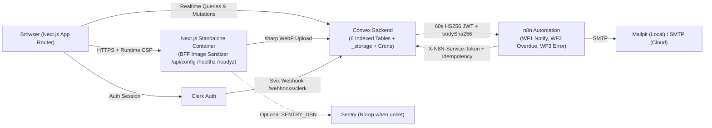

# LendLoop

LendLoop is a neighborhood tool-lending board where neighbors publish `Listing`s with sanitized photos, coordinate conflict-free `Loan`s over UTC calendar dates, and receive automated email notifications and daily `Overdue` reminders via n8n.

## Architecture



LendLoop is structured as a **domain-sliced modular monolith** across five vertical slices (`listings`, `lending`, `users`, `automation`, `audit`) with a zero-dependency pure domain core (`src/domain/`) and ESLint-enforced cross-slice seam boundaries.

### Documentation Map

- [GLOSSARY.md](GLOSSARY.md) — Canonical ubiquitous language (`User`, `Lender`, `Borrower`, `Admin`, `Trusted Lender`, `Listing`, `Loan`, `Category`, `Condition`, `Availability`, `Overdue`, `Automation Activity`, `Audit Log`).
- [CODING_STANDARDS.md](CODING_STANDARDS.md) — Judgement-call engineering and security standards.
- [docs/n8n-workflows.md](docs/n8n-workflows.md) — n8n workflow architecture, credential setup, rotation, and troubleshooting.
- [docs/aws-setup-runbook.md](docs/aws-setup-runbook.md) — 4-part AWS Console setup and operations runbook (`us-east-1` ECR, OIDC, App Runner, SSM secrets, CloudWatch, Budgets, and zero-rebuild rollback).
- Architecture Decision Records:
  - [ADR-0001: Modular Monolith & Convex Seams](docs/adr/0001-modular-monolith-and-convex-seams.md)
  - [ADR-0002: Convex-Authoritative RBAC & Dual-Path Clerk Sync](docs/adr/0002-convex-authoritative-rbac-and-dual-path-clerk-sync.md)
  - [ADR-0003: Sanitized Convex `_storage` Image Pipeline](docs/adr/0003-sanitized-convex-storage-image-pipeline.md)
  - [ADR-0004: Bidirectional n8n JWT & Service-Token Contract](docs/adr/0004-bidirectional-n8n-jwt-and-service-token-contract.md)
  - [ADR-0005: Build-Once Container & Runtime Configuration](docs/adr/0005-build-once-container-and-runtime-config.md)
  - [ADR-0006: Lean ECR & App Runner Digest Promotion](docs/adr/0006-lean-ecr-app-runner-digest-promotion.md)

## 5-Minute Local Quick Start

**Prerequisites:** Node.js 22 (`>=22 <23`), `pnpm` (`>=10`), Docker Desktop / Docker Engine with Compose v2, and a free Clerk dev application (`pk_test_*` and `sk_test_*` keys with a `convex` JWT template enabled).

1. **Install dependencies & configure `.env`:**

   ```bash
   pnpm install --frozen-lockfile
   cp .env.example .env
   ```

   Edit `.env` and set `CLERK_PUBLISHABLE_KEY` and `CLERK_SECRET_KEY` from your Clerk dashboard. When running `web` inside Docker Compose against a host `npx convex dev --local`, keep `CONVEX_URL=http://host.docker.internal:3210` (the Compose default) or point it to your Convex `dev` cloud URL.

2. **Start the local Convex backend (Terminal 1):**

   ```bash
   npx convex dev --local
   ```

   In a second shell (or Convex dashboard), set the local Convex deployment variables once:

   ```bash
   npx convex env set CLERK_JWT_ISSUER_DOMAIN "https://<your-clerk-dev-domain>.clerk.accounts.dev"
   npx convex env set N8N_WEBHOOK_URL "http://localhost:5678/webhook/lendloop-loan-notification"
   npx convex env set N8N_JWT_SECRET "local-dev-n8n-jwt-secret-change-me"
   npx convex env set N8N_SERVICE_TOKEN "local-dev-n8n-service-token-change-me"
   npx convex env set APP_URL "http://localhost:3000"
   ```

3. **Start Next.js (production standalone container), n8n (auto-imported workflows), and Mailpit (Terminal 2):**

   ```bash
   docker compose up --build
   ```

4. **Verify locally (zero public tunnels required):**
   - **App:** `http://localhost:3000` (health: `/healthz`, readiness: `/readyz`, runtime config: `/api/config`)
   - **Mailpit SMTP inbox:** `http://localhost:8025` (inspect real `Loan` notification & `Overdue` reminder emails)
   - **n8n UI:** `http://localhost:5678` (3 workflows auto-imported and Workflows 1 & 2 activated by `n8n-init`)

> **Hot-reload dev alternative:** Run `pnpm dev` alongside `npx convex dev --local` and `docker compose up n8n mailpit`.
>
> **Published-digest portability check:** To pull and run an immutable ECR `@sha256:` digest locally with zero rebuild, run `LENDLOOP_IMAGE="<account>.dkr.ecr.us-east-1.amazonaws.com/lendloop-web@sha256:<digest>" docker compose -f docker-compose.yml -f docker-compose.published.yml up --no-build`.

## Runtime Environment Variables

LendLoop enforces **zero `NEXT_PUBLIC_*` build-time env baking** (checked by ESLint). The same immutable container image runs in every environment via runtime variables exposed safely to the client through `GET /api/config` (`Cache-Control: no-store`).

### Next.js Container (`web`)

| Variable                 | Required | Default                      | Purpose                                                                         |
| ------------------------ | -------- | ---------------------------- | ------------------------------------------------------------------------------- |
| `APP_ENV`                | No       | `local`                      | Environment label (`local`, `dev`, `qa`, `staging`, `prod`).                    |
| `APP_URL`                | Yes      | `http://localhost:3000`      | Canonical application origin (used for HSTS and links).                         |
| `CONVEX_URL`             | Yes      | `http://127.0.0.1:3210`      | Convex deployment URL (`http://host.docker.internal:3210` in Compose).          |
| `CLERK_PUBLISHABLE_KEY`  | Yes      | —                            | Clerk publishable key (`pk_test_*` or `pk_live_*`).                             |
| `CLERK_SECRET_KEY`       | Yes      | —                            | Clerk server secret key (`sk_test_*` or `sk_live_*`; never exposed to browser). |
| `CLERK_FRONTEND_API_URL` | No       | Derived from publishable key | Optional explicit Clerk Frontend API origin for runtime CSP.                    |
| `SENTRY_DSN`             | No       | Unset (no-op)                | Runtime-optional Sentry DSN (`sendDefaultPii: false`, scrubs headers/tokens).   |

### Convex Deployment (`npx convex env set`)

| Variable                     | Required | Purpose                                                                                      |
| ---------------------------- | -------- | -------------------------------------------------------------------------------------------- |
| `CLERK_JWT_ISSUER_DOMAIN`    | Yes      | Clerk Issuer URL for Convex JWT verification (`convex/auth.config.ts`).                      |
| `CLERK_WEBHOOK_SECRET`       | Cloud    | Svix signing secret (`whsec_*`) for `POST /webhooks/clerk` (`user.updated`, `user.deleted`). |
| `APP_URL`                    | Yes      | Base URL embedded in outbound email links.                                                   |
| `N8N_WEBHOOK_URL`            | Yes      | Workflow 1 webhook endpoint (`.../webhook/lendloop-loan-notification`).                      |
| `N8N_JWT_SECRET`             | Yes      | HS256 signing secret for Convex → n8n 60s JWTs.                                              |
| `N8N_SERVICE_TOKEN`          | Yes      | Shared token verified in constant time for n8n → Convex HTTP calls.                          |
| `N8N_SERVICE_TOKEN_PREVIOUS` | No       | Previous token accepted during zero-downtime rotation.                                       |
| `BOOTSTRAP_ADMIN_EMAILS`     | Dev only | Comma-separated emails promoted to `admin` on initial user creation (**unset in `prod`**).   |

### Local Compose (`n8n` / `n8n-init`)

| Variable             | Required      | Purpose                                          |
| -------------------- | ------------- | ------------------------------------------------ |
| `N8N_ENCRYPTION_KEY` | Local Compose | Encrypts n8n credentials imported by `n8n-init`. |
| `N8N_JWT_SECRET`     | Local Compose | Must match Convex `N8N_JWT_SECRET`.              |
| `N8N_SERVICE_TOKEN`  | Local Compose | Must match Convex `N8N_SERVICE_TOKEN`.           |

## Security Posture Summary

- **Convex-Authoritative RBAC:** Platform `role` (`user` | `admin`) and display-only `trustedLender` live exclusively in Convex `users`. Role promotion is restricted to an internal Convex mutation (`internal.users.mutations.setUserRole`) invoked via CLI/dashboard — zero privilege-escalation UI.
- **Centralized Guards & Allow-Listed DTOs:** Every Convex query and mutation enforces `requireIdentity`, `requireRole("admin")`, `requireListingLender`, or `requireLoanParticipant`, projecting strict surface-specific DTOs (Public `/` exposes zero `Lender` identity or `storageId`; non-`Admin` users never see another `User`'s `email`, `role`, `externalId`, or `lastError`).
- **Sanitized Image Pipeline:** Uploads pass through Clerk-authenticated `POST /api/uploads/listing-image` (5 MB max, raster-only JPEG/PNG/WebP, SVG rejected, `sharp` re-encoding to WebP with `limitInputPixels: 40_000_000` stripping all EXIF/GPS/XMP) plus Convex ownership checks and rate limiting (10 uploads/min, max 10 pending per `User`).
- **Hardened HTTP & Container:** Middleware sets `X-Content-Type-Options: nosniff`, `X-Frame-Options: DENY`, `Referrer-Policy`, `Permissions-Policy`, HSTS (HTTPS prod), and a runtime-derived CSP. The standalone container runs as non-root `USER 10001` on a read-only root filesystem with `cap_drop: [ALL]` and `no-new-privileges:true`.
- **Bidirectional Automation Security:** Convex → n8n signs 60s HS256 JWTs binding `jti` and `bodySha256`; n8n → Convex authenticates via constant-time `X-N8N-Service-Token` with `PREVIOUS` rotation and `X-Idempotency-Key`.
- **Auditability & Zero-PII Telemetry:** Sensitive mutations write atomic non-PII `Audit Log` entries; structured logs and runtime-optional Sentry (`sendDefaultPii: false`) scrub emails, cookies, JWTs, and auth headers via `src/domain/redaction.ts`.

## Retention & Data Lifecycle Matrix

| Data / Table                                        | Policy                                                        | Mechanism & Schedule                                                                                                                                                            |
| --------------------------------------------------- | ------------------------------------------------------------- | ------------------------------------------------------------------------------------------------------------------------------------------------------------------------------- |
| Abandoned `listingImageUploads` (`pending`)         | Delete row + `_storage` blob after **2 hours**                | Convex hourly cron (`:15 UTC`), bounded `.take(100)` batches                                                                                                                    |
| Terminal `automationActivities` (`sent` / `failed`) | Delete after **90 days** (`pending` preserved)                | Convex daily cron (`02:00 UTC`), bounded `.take(100)` batches                                                                                                                   |
| `auditLogs`                                         | Delete after **365 days**                                     | Convex daily cron (`03:00 UTC`), bounded `.take(100)` batches                                                                                                                   |
| Archived `listings`                                 | Retained indefinitely (**0 image blobs**; deleted on archive) | Soft-delete (`archivedAt`, `archivedBy`, `archiveReason`)                                                                                                                       |
| Terminal `loans`                                    | Retained indefinitely for counterparty history                | Immutable after `returned` / `declined` / `cancelled`                                                                                                                           |
| Deleted `users` (`user.deleted` webhook)            | Anonymized tombstone retained indefinitely                    | `displayName: "Deleted User"`, `email: ""`, `externalId: "deleted:<id>"`, `trustedLender: false`; archives owned `Listing`s, deletes photos, cancels/declines `pending` `Loan`s |

## Testing & Verification Commands

| Command                | Scope                                                                                                                                                                                                                     |
| ---------------------- | ------------------------------------------------------------------------------------------------------------------------------------------------------------------------------------------------------------------------- |
| `pnpm check`           | Format check, ESLint (including modular-monolith seams & `NEXT_PUBLIC_*` ban), TypeScript `tsc --noEmit`, n8n workflow JSON hygiene, and full Vitest unit + Convex suites                                                 |
| `pnpm test:unit`       | Pure domain, security headers, runtime config, Sentry scrubbing, Zod schemas, and workflow hygiene tests                                                                                                                  |
| `pnpm test:convex`     | `convex-test` suite covering RBAC negative-case matrix, `Listing` lifecycle, `Loan` auto-decline, `Admin` panel, n8n HTTP contracts, and retention crons                                                                  |
| `pnpm test:coverage`   | Coverage report enforcing >=80% line/branch coverage on pure domain modules (`src/domain/`)                                                                                                                               |
| `pnpm test:e2e`        | Playwright container smoke + live signed n8n → Mailpit E2E against Docker Compose                                                                                                                                         |
| `pnpm test:e2e:golden` | Authenticated golden-path Playwright E2E (sign-in → create `Listing` with sanitized photo → request `Loan` as `Borrower` → approve as `Lender` → verify Mailpit notification) against live Clerk test keys + Convex `dev` |
| `pnpm check:workflows` | Verifies exported n8n JSON files contain zero real secrets, URLs, or credential IDs                                                                                                                                       |

## Day-2 Production Upgrades

1. **Multi-Account AWS Organizations & IaC:** Split `dev`/`qa`/`staging` and `prod` into separate AWS accounts managed via Terraform or AWS CDK with drift detection.
2. **Asymmetric Convex ↔ n8n Auth:** Upgrade HS256 shared secrets to short-lived RS256/ES256 JWTs verified against a rotating JWKS endpoint (or mTLS).
3. **API-Based Transactional Email:** Replace SMTP with AWS SES, Postmark, or Resend using provider idempotency tokens, bounce and complaint webhooks, and verified SPF/DKIM/DMARC records.
4. **Dedicated Production n8n Instance:** Isolate `prod` automation on a dedicated n8n deployment in queue mode (PostgreSQL + Redis) with dead-letter alerting.
5. **AWS S3 + CloudFront OAC for Images:** Swap the `convex/listings/images.ts` storage seam from Convex `_storage` to S3 + CloudFront Origin Access Control for CDN caching and lifecycle tiering.
6. **Centralized SIEM & Automated Secret Rotation:** Ship structured JSON logs and CloudTrail events to a central SIEM and automate SSM secret rotation with AWS Secrets Manager.
